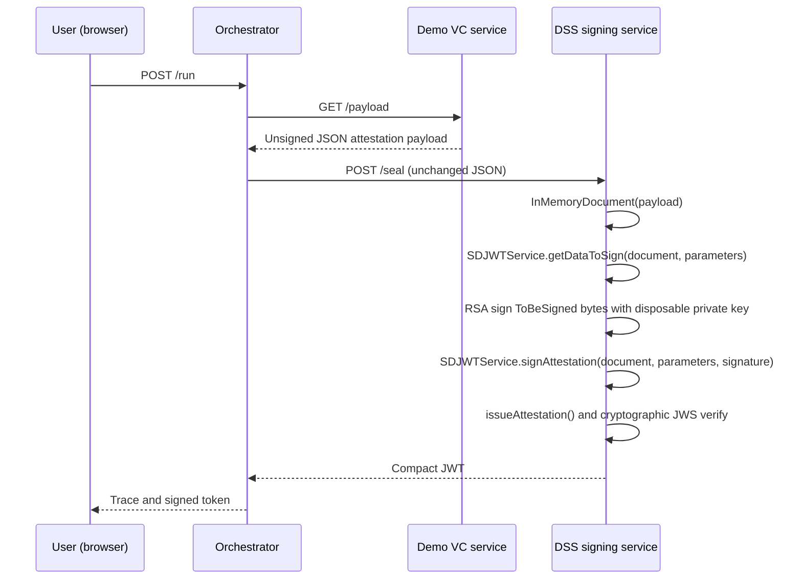

# Sequence and trust boundaries



The VC service is a **mock service**, not an external live Verifiable Credential platform. It creates a simple JSON claimset with no selective disclosures. The DSS signing container is deliberately the only component handling the private key. The demonstration does not establish QTSP status, qualified eIDAS seals, issuer trust, SD-JWT-VC profile compliance, or holder binding.

## Manual API demonstration
```bash
docker compose up --build
curl http://localhost:8080/health
curl -X POST http://localhost:8080/run
docker compose logs -f dss-service
docker compose down
```

## Production architecture
Use a real VC issuer via an authenticated service-to-service API, validate schema/claims and issuer authorization at DSS boundary, generate disclosures or transmit a validated disclosure list, use HSM / qualified trust provider for the private key, keep keys out of images, add issuer trust chain verification, enforce TLS/mTLS, event correlation IDs, audit logs, replay protection and suitable identity authorization.
